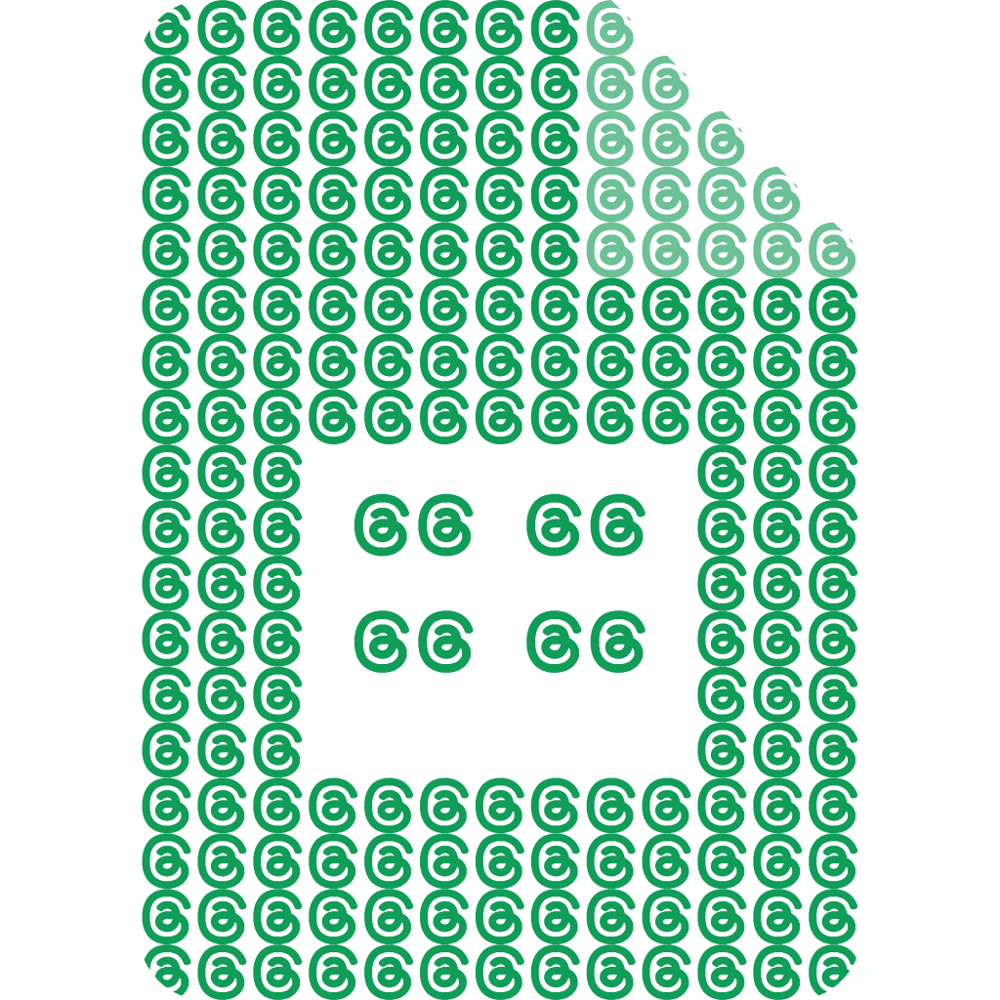
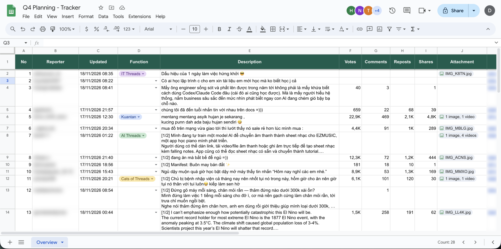

<div align="center">



# threet

**Read Threads, Reddit, and voz.vn in a Google Sheets disguise: feeds, threads, and replies as rows in a spreadsheet, right on the site.**


-lightgrey)

[](LICENSE)
[](https://ko-fi.com/dlir2404)

[About](#about) · [Install](#install) · [Quick start](#quick-start) · [Features](#features) · [Keys](#keys) · [How it works](#how-it-works) · [Privacy](#privacy-and-safety) · [Development](#development)

</div>

<p align="center">
  
</p>

## About

threet is a Chrome extension for reading Threads without looking like you are reading Threads. On threads.com it covers the page with a working copy of the Google Sheets interface (title bar, menus, toolbar, formula bar, grid, sheet tabs), and fills the grid with what the real Threads page underneath is showing: one post per row, replies and quoted posts on their own rows, threads and sub-threads as extra sheet tabs.

It is inspired by [Stealth Reader](https://thedeceiver.site), which does the same for novels. The name is *threads* + *sheet*. The Sheets look is the first skin; others (Docs, Excel, an editor) may follow.

There is no API key or threet backend: posts are parsed and displayed locally in your browser, using your existing Threads session. Loading threads and previewing media still makes requests to Threads and its media hosts.

## Install

threet is not on the Chrome Web Store yet. Install the prebuilt extension from [GitHub Releases](https://github.com/dlir2404/threet/releases/latest); no Node.js or build tools are needed:

1. Under **Assets**, download `threet-v<version>.zip` (not **Source code**).
2. Extract the ZIP into a folder you will keep. It contains `manifest.json`, the extension code, fonts, and licenses.
3. Open `chrome://extensions` and turn on **Developer mode**.
4. Click **Load unpacked** and select the extracted folder containing `manifest.json`.
5. Open [threads.com](https://www.threads.com) and log in as usual.

Keep that folder after installation: Chrome loads the extension from it. To update, replace its contents with the new release's files, click **Reload** on the extension in `chrome://extensions`, and reload your Threads tabs. Unpacked extensions can't update themselves, so threet checks GitHub Releases once a day and shows a dialog with the download link and these steps when a new version is out.

**Browser:** Chrome (or another Chromium browser with Manifest V3).

### Build from source

If no release is available yet, or you want to develop threet:

```sh
git clone https://github.com/dlir2404/threet.git
cd threet
npm ci
npm run build          # → dist/
```

1. Open `chrome://extensions` and turn on **Developer mode**.
2. **Load unpacked** → choose the `dist/` folder.
3. Open [threads.com](https://www.threads.com) and log in as usual.

**Build requirements:** For the current build and test toolchain, use Node.js 24.15.0 or later within the 24.x series (CI uses 24.20.0). Node.js 22.22.2 or later within 22.x, and Node.js 26+, are also supported by the installed Vitest and jsdom versions.

## Supported sites

| Site | What becomes rows | Opening a post |
| --- | --- | --- |
| [Threads](https://www.threads.com) | Feeds, profiles, saved/liked; surfaced replies and quoted posts | Thread and sub-threads, in a hidden iframe |
| [Reddit](https://www.reddit.com) | Home, popular, subreddits, user pages: title, subreddit or flair, score, comments | Post with its comment tree (`2.1.1`), in a hidden iframe |
| [voz.vn](https://voz.vn) | Forum index, sub-forums, and thread lists, with prefix, replies, views | Thread posts with `#n` numbers, quotes that jump to the original post, and reactions; pages fetched in the background, with a page pager and whole-thread search |

Each site is an adapter under [`src/sites/`](src/sites); its domains live in [`src/sites/hosts.json`](src/sites/hosts.json), which also drives the manifest. threet is read-only on every site: it never posts, votes, or sends anything.

## Quick start

Open threads.com (or a supported site above). The sheet appears immediately (the real page never flashes) and a short guide opens the first time. Then:

- Move with the arrow keys; the formula bar shows the full text of the selected cell. Press **Space** to read a long post inside its cell.
- Press **Enter** on a post to open its thread as a new sheet tab; **Enter** on a reply opens that sub-thread. **Backspace** closes the tab and goes back.
- Scroll to the bottom (or press **m**) to load more; **r** fetches new posts.
- Someone walks by: **Esc** switches to a boring "Q4 Budget" sheet. **Esc** again to come back.
- **⌥T** (Alt+T) turns the sheet off and shows the real page: the feed, or the thread you were on.

## Features

- **Looks like Sheets.** The browser tab reads `<title> - Google Sheets` with a Sheets icon; the doc title and column titles are editable (double-click) and remembered; columns resize; zoom works.
- **Feed as rows.** Author, time, topic (as a dropdown chip), text, likes, replies, reposts, shares, attachments, and post ID. Replies Threads surfaces under a post become `5.1`; quoted posts get their own `5.q` row.
- **Threads and sub-threads as sheet tabs.** Ancestors in grey, the post in bold, replies numbered by depth (`2.1.1`). Right-click a tab for Delete / Rename / Move, just like Sheets.
- **Nothing skipped while scrolling.** Threads renders only the posts near the screen; threet walks the list step by step so every post lands in the sheet.
- **Media and links.** Image and video chips with a hover preview and a viewer; link previews as link chips; Threads labels ("Original author liked") as cell notes.
- **Boss key and a real "show original".** Esc for the decoy sheet, ⌥T for the real page.
- **Find.** On voz, ⌘F searches the whole thread (or forum) with the forum's own search: type keywords and/or a poster name, press Enter, and the hits open as a 🔍 sheet where Enter jumps to the page that has the post. On Threads and Reddit, ⌘F works like Sheets: it highlights matching cells in the loaded rows (text or author, accent-insensitive when you type without accents), and the funnel hides everything else.
- **Big forum threads.** One page at a time, like the forum: the status bar shows `Page 3 / 150`, `,` and `.` go to the page before or after, `g` jumps to any page, and ⇧Enter opens a thread at its newest page. Quotes show as a grey block at the top of the reply's cell, like on the forum; click it (or press q) to jump to the original post, loading its page or opening its thread if needed, and Backspace comes back.
- **Keyboard first.** Every action has a key; F1 lists them.

## Keys

| Key | Action |
|---|---|
| `↑ ↓ ← →` · `j k h l` · `Tab` | Move between cells (`PageUp`/`PageDown` jump 10 rows) |
| `Enter` · `o` · double-click | Open the thread / sub-thread in a new sheet tab (on an attachment: view it) |
| `Backspace` · `u` · `⌥←` | Close the current thread tab and go back |
| `Space` · `F2` · `e` | Read the whole cell in place |
| `⌘⇧U` | Expand the formula bar |
| `[` `]` · `⌥↑` `⌥↓` | Previous / next sheet tab |
| `m` · `End` | Load more |
| `r` | New posts (Data → Refresh data) |
| `p` | Image previews on hover on/off |
| `⌘+` `⌘-` | Zoom |
| `⌘C` | Copy the cell |
| `Esc` | Boss key |
| `⌥T` | Turn the sheet off / on |
| `F1` · `?` · `⌘/` | Guide and shortcuts |

Clicking the extension icon also toggles the sheet.

## How it works

```text
 threads.com tab
 ├── the real Threads page        ← driver: watches the DOM, scrolls to load more
 ├── thread iframes (≤ 3, hidden) ← one per open thread sheet, same origin, inert
 └── <threet-root> shadow DOM     ← the Sheets UI, covering everything
          ▲
          └── parser → store → sheet model → grid
```

- **Parser** reads posts from the live DOM without relying on Threads' generated class names: `data-pressable-container`, permalinks with `<time>`, `dir="auto"` text runs, and the like/reply/repost/share button group.
- **Driver** follows the page's client-side routing, walks the virtualised list to load more, and keeps every post it has seen, even after Threads unmounts it.
- **Thread sheets** are backed by a same-origin `<iframe>` of the thread page, laid out under the sheet, so opening a thread never navigates the feed underneath. Threads normally refuses to be framed (`X-Frame-Options: DENY`, and an error page for `Sec-Fetch-Dest: iframe`); a [`declarativeNetRequest`](https://developer.chrome.com/docs/extensions/reference/api/declarativeNetRequest) rule lifts that **only for frames that threads.com opens itself**, so other sites still cannot frame Threads. If a frame does not render within 8 seconds, threet falls back to navigating the page.
- **Other sites.** Reddit thread sheets use the same hidden-iframe approach (Reddit allows same-origin framing, so no header rule is needed). voz.vn is a classic paginated forum, so threet fetches the next page or a thread with your cookies and parses it with `DOMParser`; the real page never navigates. Search is the one exception: Cloudflare only lets the search form through as a real navigation, so threet submits it into a hidden same-origin iframe, the same request the site's own search box makes.
- **UI** is Preact in a shadow root, styled after the current Sheets design; icons are Material Symbols and the UI font is Google Sans.

## Privacy and safety

- **Local processing and network requests.** threet has no backend or analytics service; it parses and displays posts locally. Opening thread sheets loads real Threads pages in iframes, scrolling can trigger Threads to fetch more posts, and media previews load images from their source URLs. These requests use the normal Threads pages and media hosts. Fonts and icons are bundled with the extension.
- **Update check.** At most once a day (hourly retry after a failure), the extension's background makes one anonymous GET to `api.github.com/repos/dlir2404/threet/releases/latest`, falling back to `data.jsdelivr.com` when GitHub's API is unreachable. Nothing about you or your feed is sent. When a newer release exists, a dialog offers the download (Remind later = 24 h, or Skip this version). Turn it off in **Help → Tự kiểm tra cập nhật hằng ngày**.
- **Storage.** Settings (doc title, column titles and widths, zoom) are kept in `chrome.storage.local`. Read rows, open sheet tabs, and selections are kept in memory and saved to the tab's `sessionStorage` after relevant state changes (with an 800 ms debounce). The snapshot is restored only when threet triggers a full page navigation and leaves a marker less than 20 seconds old; an ordinary reload starts fresh and clears the snapshot. This cache belongs to the Threads page's origin, so it is accessible to that page's scripts.
- **Permissions.** `storage`, host access to `threads.com` / `threads.net`, and `declarativeNetRequestWithHostAccess` for the framing rule above. The release build has no `debugger` permission and no debug code.
- **Read-only.** threet does not like, post, follow, or reply on your behalf.
- **Use it responsibly.** It is a personal reading tool. Respect Threads' terms and your workplace's rules; it may break whenever Threads changes its page.

## Roadmap

- [x] Sheets skin: feed, threads, sub-threads, quotes, media, links
- [x] Infinite scroll without gaps; thread tabs in iframes
- [x] Boss key, show original, in-app guide
- [ ] Reply and like from the sheet (comments as Sheets comments)
- [ ] Profiles and search as sheets
- [ ] More skins: Google Docs, Excel, VS Code
- [ ] Settings page; Chrome Web Store release

## Development

```sh
npm run dev          # watch build → dist-dev/ (load this one unpacked while developing)
npm test             # parser and store tests
npm run typecheck
```

- `dist-dev/` includes a debug bridge to the **threet-debug** MCP server (`mcp/server.mjs`, declared in `.mcp.json`), so an agent such as Claude Code can inspect state, read the live DOM, evaluate JS, take screenshots, send input, and reload the extension in your Chrome. It only accepts connections from a `chrome-extension://` origin carrying the token in `.threet-dev-token` (generated, gitignored). `dist/` contains none of it.
- `node scripts/preview.mjs [saved-page.html] --dist dist-dev` serves a saved Threads page (scripts stripped) with the built overlay for offline checks; `node scripts/smoke-mcp.mjs` smoke-tests the MCP server.
- Eight parser tests run against a page you save yourself to `test/fixtures/feed-home.html`. Fixtures contain other people's posts, so they are gitignored. On a fresh clone, those eight tests are skipped; the remaining ten tests run without the fixture. Check the skipped count before treating a passing run as full parser coverage.
- Automated tests currently cover parser helpers, the saved feed fixture, the Reddit and voz.vn parsers (synthetic markup), store merging, and sheet row modeling. Navigation, iframe fallback, keyboard interactions, and the UI still need manual checks in Chrome against live Threads. GitHub Actions runs typecheck, tests, and production packaging on pull requests, pushes to `main`, and version tags; the private fixture tests are skipped in CI.

Source layout:

```text
src/content/parser.ts   DOM → posts, groups, thread rows
src/content/driver.ts   page routing, loading more, navigation fallbacks
src/content/frames.ts   thread iframes
src/content/store.ts    tabs, lists, threads, settings
src/content/sheet.ts    posts → columns and rows
src/content/ui/         the Sheets UI (Preact)
src/background/         toolbar toggle; dev-only debug link
mcp/server.mjs          dev-only MCP server
```

## Contributing

Issues and pull requests are welcome. Threads changes its markup often; parser fixes with a test (and a description of the DOM you saw) are especially useful.

```sh
npm run typecheck && npm test && npm run build
```

### Publishing a release

The [Build and release workflow](.github/workflows/build-release.yml) publishes a GitHub Release with an installable ZIP when a `v<version>` tag is pushed. The tag must match `package.json`; for example, `v0.1.0` requires version `0.1.0`. Only the release job has permission to publish. It uses GitHub's built-in token, so no extra secret is needed.

For the first release, after the workflow is committed and pushed:

```sh
git tag v0.1.0
git push origin v0.1.0
```

For subsequent releases, update the version and lockfile with `npm version patch --no-git-tag-version` (or `minor` / `major`), commit and push those changes, then tag that commit with the new version and push the tag. Check the workflow run under **Actions**; the release is published only after checks and packaging succeed. Use a new version tag for changed releases.

To build the same ZIP locally, run `npm run package` (requires the `zip` command). The result is `build/release/threet-v<version>.zip`, with `manifest.json` at the archive root. Build output remains gitignored. Successful CI runs also keep the ZIP as a `threet-extension` artifact for 14 days; running the workflow manually builds an artifact without publishing a release.

## Support

threet is free and open source. If it makes your day a little better, you can support its development:

[](https://ko-fi.com/dlir2404)

Bug reports, ideas, and pull requests help just as much.

## Security

Please report vulnerabilities privately through [GitHub security advisories](https://github.com/dlir2404/threet/security/advisories/new) rather than public issues.

## Disclaimer

threet is an independent project. It is not affiliated with, endorsed by, or sponsored by Google or Meta. Google Sheets is a trademark of Google LLC; Threads is a trademark of Meta Platforms, Inc. The Sheets-like interface is recreated from scratch; no code or assets from Google Sheets are included. The icon set and UI font are Google's open-source releases, used under their licenses below.

The threet logo is a playful mashup: a spreadsheet-file silhouette drawn entirely with the Threads glyph (traced from Threads' public app icon). It refers to both products to describe what threet does and implies no endorsement. Source and build script: [assets/branding/source](assets/branding/source).

Third-party components: [Google Sans](https://fonts.google.com/specimen/Google+Sans) (SIL Open Font License 1.1, via Fontsource), [Material Symbols](https://github.com/google/material-design-icons) (Apache License 2.0), [Preact](https://preactjs.com) (MIT).

## License

Copyright 2026 dlir2404.

Licensed under the [Apache License, Version 2.0](LICENSE). Contributions are accepted under the same license.
